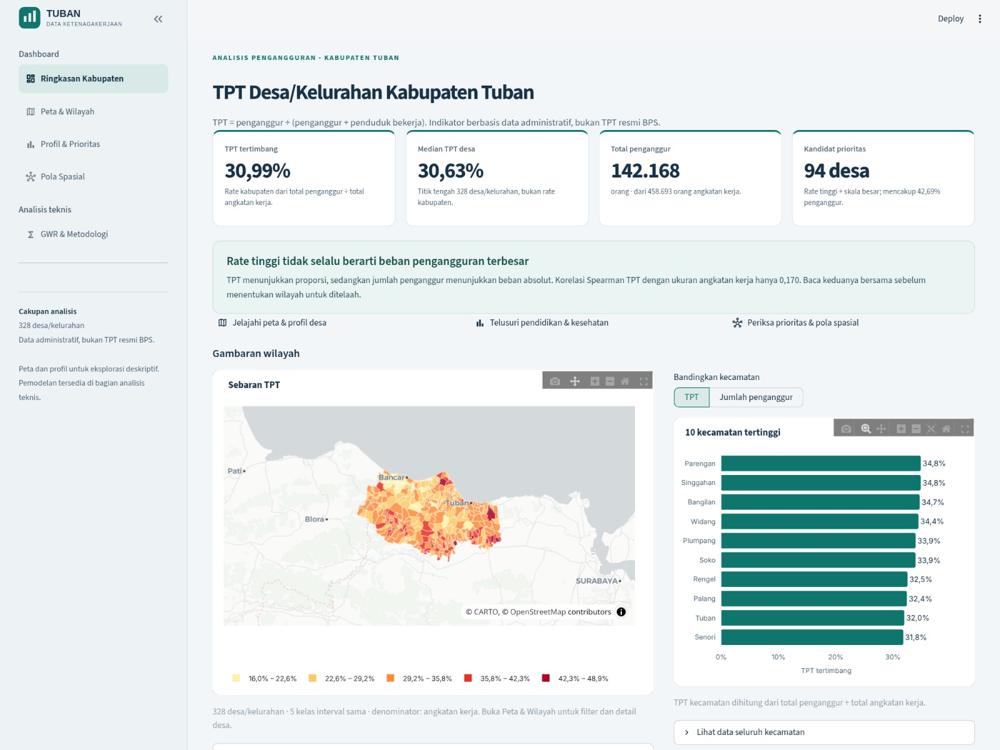

# Pengangguran Kabupaten Tuban 2026

[](https://github.com/TitoTFP/KerjaPraktik/actions/workflows/quality.yml)

Proyek kerja praktik di **PDPM ITS** yang memetakan pengangguran di Kabupaten Tuban. Dashboard interaktif membantu membandingkan tingkat dan jumlah pengangguran antardesa dan antarkecamatan. Laporan menjelaskan data, metode, dan hasil analisis.



*Cuplikan halaman Ringkasan Kabupaten dari laporan kerja praktik.*

## Mulai cepat

### Jalankan dashboard

Prasyarat: Python 3.12 atau lebih baru dan [uv](https://docs.astral.sh/uv/getting-started/installation/).

```bash
git clone https://github.com/TitoTFP/KerjaPraktik.git
cd KerjaPraktik
uv sync --locked --extra dashboard
uv run --locked --extra dashboard streamlit run app.py
```

Buka [localhost:8501](http://localhost:8501). Dashboard memakai hasil analisis yang sudah dihitung di [`dashboard_data/`](dashboard_data/) dan geometri dari [`Datasets/`](Datasets/); tidak perlu menjalankan ulang analisis spasial atau pemodelan.

### Render laporan

Pasang [Quarto](https://quarto.org/docs/get-started/), lalu jalankan dari root repositori:

```bash
quarto render laporan
```

Hasilnya adalah `laporan/_output/index.html` dan `laporan/_output/laporan.docx`. Sumber [Quarto Book](laporan/index.qmd) mencakup Bab I–V. Gambar analisis sudah disertakan, jadi render tidak perlu menjalankan generator Python.

## Data dan interpretasi

- [CSV pengangguran yang telah diaudit](Datasets/Data_Pengangguran_Clean_Audited_8_Sep_2026.csv) memuat hitungan agregat serta profil pendidikan, kesehatan, dan lapangan pekerjaan.
- [GeoJSON batas desa/kelurahan](Datasets/Kabupaten%20Tuban-KEL_DESA.geojson) menyediakan geometri untuk peta.
- Tingkat Pengangguran Terbuka (TPT) dalam proyek ini dihitung dari data administratif dengan rumus `penganggur / (penganggur + penduduk bekerja) × 100%`. **Angka ini bukan TPT resmi BPS.** Hasil deskriptif tidak menunjukkan hubungan sebab-akibat.

## Dokumentasi

| Kebutuhan | Panduan |
| --- | --- |
| Memahami kolom dan batas interpretasi | [Kamus data](docs/kamus-data.md) |
| Menelusuri susunan laporan | [Kerangka laporan](docs/kerangka-laporan.md) |
| Menghasilkan ulang grafik dan peta Bab IV | [Reproduksi aset Bab IV](docs/reproduksi-bab-iv.md) |
| Mengelola sitasi dan merender laporan | [Panduan Quarto, Pandoc, dan Zotero](docs/panduan-referensi.md) |
| Menjalankan dashboard di server | [Deployment systemd dan Cloudflare Tunnel](deploy/systemd/README.md) |
| Menjalankan pemeriksaan dan mengirim perubahan | [Panduan kontribusi](CONTRIBUTING.md) |

## Kontribusi dan bantuan

Laporkan masalah atau ajukan usulan melalui [GitHub Issues](https://github.com/TitoTFP/KerjaPraktik/issues). Sebelum membuka pull request, ikuti [panduan kontribusi](CONTRIBUTING.md) untuk alur kerja dan pemeriksaan lokal.

## Kredit dan lisensi

Dashboard dikembangkan oleh **Daffa Dzaky Mumtaz** dan **Tito Fauzan Putra** sebagai proyek kerja praktik di **Pusat Studi Potensi Daerah dan Pemberdayaan Masyarakat (PDPM ITS)**. Logo dashboard bersumber dari [Logo dan Lambang PDPM ITS](https://www.its.ac.id/pdpm/logo-dan-lambang-pdpm/).

Repositori ini belum memiliki lisensi proyek. Akses publik bukan izin untuk menggunakan ulang atau mendistribusikan kode, laporan, data, atau logo. Periksa izin dan ketentuan atribusi dari pemegang hak masing-masing.
