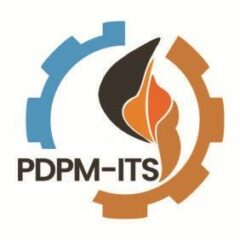

#  GAMBARAN UMUM TEMPAT KERJA PRAKTIK

## Sejarah Tempat Kerja Praktik

Pusat Studi Potensi Daerah dan Pemberdayaan Masyarakat (PDPM) adalah pusat studi di bawah DRPM ITS yang memiliki kompetensi khusus di bidang pengembangan potensi daerah berbasis pemberdayaan masyarakat. PDPM memberikan layanan terbaik berupa riset, pelatihan, dan pendampingan dalam berbagai aspek pembangunan dengan dukungan tenaga ahli yang kompeten. PDPM melaksanakan kajian dampak kegiatan pembangunan atau program, baik oleh perusahaan/instansi maupun pemerintah; kajian kewilayahan dan pemetaan kondisi lingkungan dan sosial; penyusunan indikator sosial-ekonomi, lingkungan, dan pembangunan. PDPM telah berhasil mengembangkan kerjasama dan jaringan yang cukup luas baik nasional maupun internasional melalui lembaga pemerintah dan swasta.

PDPM sendiri telah berdiri sejak tahun 2000 yang mana telah mengikuti sejarah nama-nama intansi terdahulu sebelum menjadi PDPM dan pemimpin yang telah memimpin berdirinya intansi PDPM. Berikut penjelasan sejarah berdirinya.

1. Tahun 2000-2004 adalah berdirinya intansi dan memiliki nama Pusat Pengkajian Pengembangan Potensi Daerah (P4D) dimana dipimpin oleh Dr. Dra. Agnes Tuti Rumiati, M.Sc. yang menjabat selama 5 tahun.
2. Tahun 2005-2009 berganti nama menjadi Unit Pengkajian Pengembangna Potensi Daerah (UP3D) dimana dipimpin oleh Prof. Ir. Eddy Setiadi Soedjono, Dipl.SE., M.Sc., Ph.D. yang menjabat selama 5 tahun.
3. Tahun 2009-2012 terjadi pergantian pemimpin yang dipimpin oleh Ibu Ages dan Prof Eddy sebagai wakilnya dan nama intansi masih sama.
4. Tahun 2012-2016 berganti nama menjadi Pusat Kajian Potensi Daerah dan Pemberdayaan Masyarakat (Pusat Kajian PDPM) dimana dipimpin oleh Dr. Sutikno, S.Si., M.Si. dan Alfan Purnomo, S.T., M.T. sebagai wakilnya yang mana menjabat selama 5 tahun.
5. Tahun 2016-2019 terjadi pergantian pemimpin yang dipimpin oleh Prof. Dr. Ir. Setiawan, M.S.
6. Tahun 2019-2024 pergantian pemimpin yang dipimpin oleh Bapak Sutikno dan Dr. Soedarso, M.Hum. sebagai wakilnya.
7. Tahun 2024-sekarang berganti nama menjadi Pusat Studi Potensi Daerah dan Pemberdayaan Masyarakat (Pusat Studi PDPM) dimana masih dipimpin oleh Bapak Sutikno dan Ibu Rulli Pratiwi Setiawan, S.T., M.Sc., Ph.D. sebagai wakilnya.

. {width="1.474359142607174in" height="1.474359142607174in"}

[]{#_Toc215385159 .anchor}**Gambar 2.1** Logo Pusat Studi PDPM ITS

Sumber: *Website* PDPM ITS

Adapun penjelasan logo dari PDPM ITS pada Gambar 2.1 yang dijabarkan penjelasan pada masing-masing bagian.

1. Logo PDPM ITS, terdiri dari roda gerigi yang di dalamnya terdapat ornamen berupa penyederhanaan bentuk huruf PDPM yang menyerupai kuncup bunga dan tulisan PDPM-ITS.
2. Roda Gerigi, melambangkan PDPM adalah bagian dari ITS
3. Kuncup Bunga PDPM, melambangkan bahwa PDPM sebagai sebuah lembaga yang memiliki kompetensi khusus di bidang pengembangan potensi daerah berbasis pemberdayaan masyarakat. Kuncup bunga sebagai lambang harapan masa depan dalam pengembangan potensi daerah secara berkelanjutan.
4. Ornamen PDPM, menyerupai bentuk kepalan tangan yang mengacungkan jempol sebagai simbol "like this", sebuah ungkapan modern untuk apresiasi dan ajakan pemberdayaan masyarakat untuk mengembangkan daerahnya masing-masing
5. Tulisan PDPM-ITS, sebagai penanda untuk memudahkan komunikasi  pengenalan akronim PDPM adalah bagian dari ITS.

## Visi dan Misi

Visi dan misi dari PDPM ITS dalam menjalankan tugas dan fungsinya.

### Visi

> "Menjadi pusat studi unggulan bereputasi nasional dan internasional di bidang pengembangan potensi daerah dan pemberdayaan masyarakat agar dapat berkontribusi pada pembangunan Indonesia berkelanjutan melalui inovasi dan kolaborasi"

### Misi

Adapun misi untuk menunjang keberhasilan dari visi tersebut, berikut adalah misi dari Pusat Studi PDPM ITS.

a. Melakukan riset inovasi dan kolaborasi dengan pemangku kepentingan dalam pengembangan potensi daerah dan pemberdayaan masyarakat untuk mendukung pembangunan yang berkelanjutan dan inklusif.
b. Mengembangkan metodologi untuk menghasilkan program penyelesaian persoalan pembangunan, sosial, ekonomi, kesejahteraan, kesehatan, dan lingkungan yang terjadi di Indonesia.
c. Mengintegrasikan berbagai pihak diantaranya akademisi, pemerintah, industri, dan masyarakat untuk berkontribusi dalam pembangunan yang memberikan dampak pada peningkatan kesejahteraan masyarakat dan lingkungan.
d. Meningkatkan kapasitas dan kompetensi masyarakat melalui program pelatihan, pendampingan, dan advokasi berbasis partisipasi.
e. Memperluas jaringan kerja sama nasional dan internasional dalam bidang pembangunan daerah dan pemberdayaan masyarakat untuk memperkuat daya saing dalam mencapai Tujuan Pembangunan Berkelanjutan.

## Struktur Organisasi

Struktur organisasi adalah kerangka kerja yang mengatur hubungan dan tanggung jawab antara berbagai elemen atau bagian di dalam suatu organisasi. Dikutip dari laman resmi *website* www.its.ac.id/pdpm, struktur organisasi sebagai berikut.

![[]{#_Toc215385161 .anchor}**Gambar 2.2** Struktur Organisasi Pusat Studi PDPM ITS](../docx-media/media/image3.png){width="3.1247845581802274in" height="3.002739501312336in"}

Sumber: *Website* PDPM ITS

Berdasarkan Gambar 2.2, terdapat bagian-bagian dalam organisasi dimana dibagi menjadi kepala pusat studi, wakil, tenaga ahli dan asisten, bagian operasional, dan tim teknis dan pelaksana lapangan. Berikut adalah uraian singkat bagian-bagian dalam organisasi yang ada di PDPM ITS.

1. Kepala Pusat Studi PDPM ITS

   Kepada pusat studi adalah pemegang tertinggi dalam bertanggung jawab langsung terhada seluruh arah kebijakan riset, kerja sama eksternal, dan pengabdian masyarakat.
2. Wakil Pusat Studi PDPM ITS

   Wakil pusat studi sebagai yang membantu membantu menyelaraskan kajian teknis tata ruang, perencanaan wilayah, dan operasional internal harian.
3. Tenaga Ahli dan Asisten Tenaga Ahli

   Tenaga ahli adalah koordinasi khusus pimpinan (ditandai garis putus-putus) untuk memberikan masukan spesifik/metodologi dalam proyek kajian daerah tertentu.
4. Bagian Operasional

   Bagian operasional PDPM ITS terdapat 4 bagian untuk mengatur fungsi-fungsi yang ada di PDPM ITS.

   a. Bagian Penelitian dan Abmas.
   b. Bagian Keuangan.
   c. Bagian Administrasi.
   d. Bagian Penelitian dan Lapangan.
5. Tim Teknis dan Pelaksana Lapangan

   Tim teknis di PDPM ITS dalam menjalankan teknis di lapangan terdapat beberapa strukturnya.

   a. Supervisor, sebagai pengawas kualitas jalannya pengambilan data di area-area sampel wilayah.
   b. Quality Control, yang memastikan data terkumpul, konsisten, dan memenuhi kaidah metodologi.
   c. Data Entry Personal, yang bertanggung jawab untuk input, pembersihan, dan tabulasi data ke dalam sistem.
   d. Surveyor, sebagai yang melakukan wawancara di lapangan.

## Bidang Fokus Pusat Studi PDPM ITS

Pusat Studi PDPM ITS dalam kegiatan yang dilakukan berfokus pada 6 bidang. Berikut adalah 6 bidang fokus.

1. Bidang Pemberdayaan Masyarakat dan *Corporate Social* Responsibility (CSR)
2. Bidang Pengembangan Wilayah & Tata Ruang
3. Bidang Infrastruktur & Lingkungan
4. Bidang Desain Produk, Inovasi, & Ergonomi
5. Bidang Statistik, Survei, & Pemetaan Sosial
6. Bidang Ekonomi & Kebijakan Publik.
