#  HASIL KERJA PRAKTIK

##  *Exploratory Data Analysis* (EDA)

EDA dilakukan untuk mengetahui karakteristik data pengangguran sebelum menentukan dan membuat metode statistika yang sesuai. Data pengangguran di Kabupaten Tuban tahun 2026 terdapat jumlah penganggur, jumlah pendidikan terakhir, jumlah penyakit kronis, dan jumlah sektor pekerjaan per desa/kelurahan.

### Tingkat Pengangguran Terbuka

> Dalam mengetahui berapa persen yang menganggur di suatu wilayah maka jumlah penganggur masing-masing wilayah dibagi dengan jumlah angkatan kerja masing-masing wilayah. Nilai persen tersebut disebut Tingkat Pengangguran Terbuka (TPT) yang diperlukan sebagai variabel respon untuk analisis peta, model, dan grafik. Langkah yang diperlukan untuk memahami data TPT sebagai berikut.

1. Distribusi TPT

> Distribusi pada data perlu dilakukan pengecekan apakah berdistribusi normal atau tidak pada data TPT. Berikut adalah plot histogram dan boxplot yang disajikan pada Gambar 4.1.

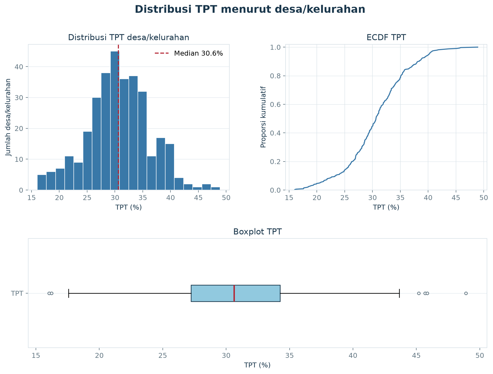{width="3.2376902887139107in"}

> Berdasarkan Gambar 4.1, grafik histogram menunjukkan bahwa data TPT mendekati normal dan sedikit menceng ke kanan. Nilai rata-rata yang dihasilkan juga 30,72% yang mana lebih besar dari nilai median yang sekitar 30,63% artinya beberapa desa/kelurahan memiliki nilai TPT yang tinggi yang menaikkan nilai rata-rata tersebut. Grafik boxplot menunjukkan bahwa sebaran data tengah relatif tepat dan terlihat beberapa titik *outlier* di sisi kanan yang nilai TPT beberapa desa/kelurahan itu tinggi. Untuk menguji kesesuaian data terhadap distribusi normal, dilakukan pula analisis Q*-Q plot* yang disajikan Gambar 4.2 berikut.

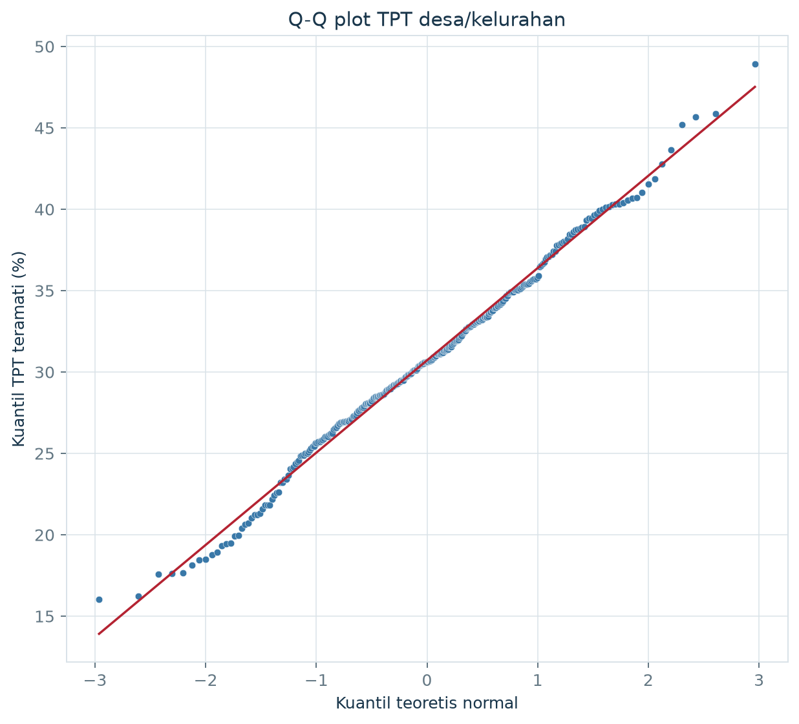{width="3.2944444444444443in"}

> Berdasarkan Gambar 4.2, yang memperlihatkan bahwa sebagian besar titik data mengikuti garis referensi normal pada bagian tengah distribusi. Akan tetapi, terdapat penyimpangan pada kedua ujung distribusi, di mana titik-titik pada ekor kanan berada di atas garis referensi mengindikasikan ekor kanan yang lebih panjang (*heavy tail*) dan sejalan dengan cek *outlier* pada boxplot sementara titik-titik pada ekor kiri berada sedikit di bawah garis referensi.

2. Pemetaan TPT

Adapun pemetaan variabel respon Tingkat Pengangguran Terbuka (TPT) untuk mengetahui daerah mana saja yang memiliki persentase rendah dan tinggi. Peta disajikan menurut desa/kelurahan, kecamatan, dan wilayah fokus enam kecamatan pada Gambar 4.3–4.5.

> 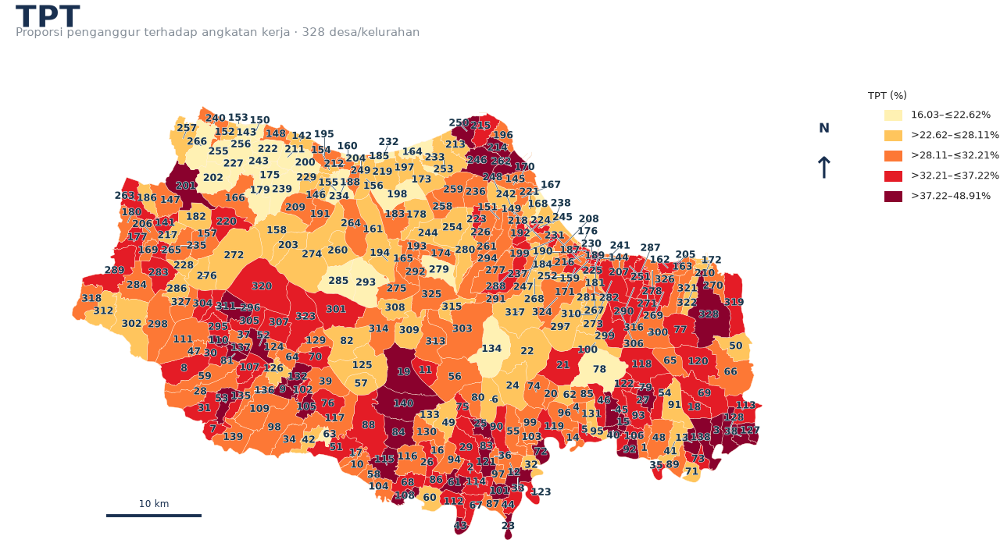{width="6in"}
>
> **Gambar 4.3** Peta TPT Menurut Desa/Kelurahan
>
> Gambar 4.3 menunjukkan variasi TPT pada 328 desa/kelurahan, dengan rentang 16,03–48,91%. Kelas terbanyak adalah >28,11–≤32,21% (105 desa; 32,0%), sedangkan 123 desa (37,5%) berada pada dua kelas tertinggi (>32,21%). Batas *Natural Breaks* mengelompokkan nilai relatif terhadap distribusi data; kelas-kelas ini bukan ambang kebijakan.
>
> TPT tertinggi tercatat di Desa Cangkring, Kecamatan Plumpang (fid 15), yaitu 48,91% (292 penganggur dari 597 angkatan kerja); terendah di Desa Mergoasri, Kecamatan Parengan (fid 63), 16,03% (67 dari 418). TPT adalah proporsi, bukan jumlah penganggur: Desa Sumurgeneng di Kecamatan Jenu memiliki TPT 45,85% dengan 730 penganggur, lebih banyak daripada Cangkring meskipun persentasenya lebih rendah. Perbandingan ini menunjukkan bahwa TPT sebagai ukuran relatif dan jumlah penganggur sebagai angka absolut menggambarkan aspek yang berbeda.
>
> Secara visual, peta memperlihatkan variasi antardesa; kedekatan warna hanya pola deskriptif dan tidak dengan sendirinya membuktikan hubungan spasial atau menjelaskan penyebab pengangguran.

> 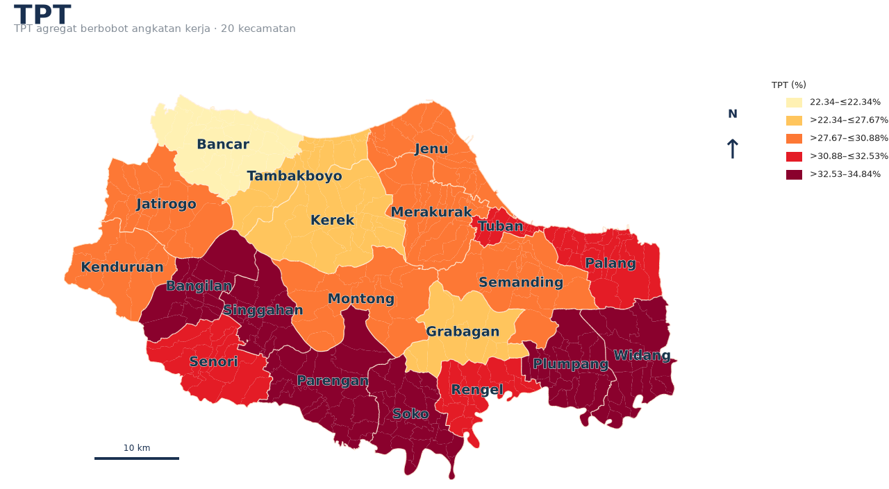{width="6in" fig-alt="Peta TPT agregat untuk 20 kecamatan di Kabupaten Tuban, dikelompokkan dalam lima kelas Natural Breaks dan diberi label nama kecamatan."}
>
> **Gambar 4.4** Peta TPT Menurut Kecamatan
>
> TPT kecamatan dihitung dari jumlah penganggur dibagi total angkatan kerja kecamatan (penganggur + penduduk bekerja), sehingga bukan rata-rata TPT desa. Nilainya berkisar dari 22,34% di Bancar (6.143 penganggur; 21.360 bekerja) hingga 34,84% di Parengan (7.495 penganggur; 14.015 bekerja), selisih 12,51 poin persentase.
>
> Enam dari 20 kecamatan berada pada kelas *Natural Breaks* tertinggi (>32,53–34,84%); nilai keenamnya dalam data berkisar 33,92–34,84%: Parengan (34,84%), Singgahan (34,84%), Bangilan (34,67%), Widang (34,44%), Plumpang (33,95%), dan Soko (33,92%). Batas kelas menunjukkan pengelompokan relatif antarkecamatan, bukan ambang kebijakan atau bukti penyebab tertentu.
>
> TPT dan jumlah penganggur memberi informasi berbeda: Bancar memiliki TPT terendah, tetapi tetap mencatat 6.143 penganggur. Gambar 4.5 memperlihatkan variasi TPT pada desa/kelurahan di enam kecamatan kelas agregat tertinggi.
>
> 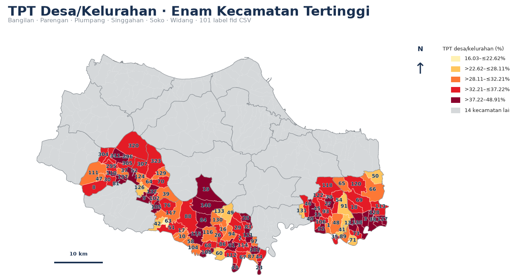{width="6in" fig-alt="Peta tunggal Kabupaten Tuban dengan desa/kelurahan di enam kecamatan TPT agregat tertinggi diwarnai menurut TPT desa dan diberi label fid numerik; 14 kecamatan lain ditampilkan abu-abu."}
>
> **Gambar 4.5** Peta TPT Desa/Kelurahan pada Enam Kecamatan dengan TPT Agregat Tertinggi
>
> Gambar 4.5 memusatkan perhatian pada 101 desa/kelurahan di enam kecamatan yang berada di kelas TPT agregat tertinggi pada Gambar 4.4. Meskipun wilayah dipilih berdasarkan TPT kecamatan, warna pada peta menunjukkan TPT masing-masing desa/kelurahan; batas kelas *Natural Breaks* sama dengan Gambar 4.3, sehingga perbandingan kelas tetap memakai acuan seluruh 328 desa.
>
> Pada 101 desa/kelurahan fokus, jumlah pada lima kelas *Natural Breaks* dari terendah ke tertinggi berturut-turut 1, 10, 23, 37, dan 30. Dengan demikian, 67 (66,3%) berada pada dua kelas tertinggi (>32,21%), sementara 34 (33,7%) berada pada tiga kelas lebih rendah; rentang TPT desa dalam peta tetap 16,03–48,91%. Hasil ini menunjukkan bahwa kecamatan pada kelas agregat tertinggi tidak berarti seluruh desa di dalamnya memiliki TPT tinggi.
>
> Warna abu-abu hanya menandai 14 kecamatan di luar fokus; warna tersebut tidak menyatakan TPT rendah atau ketiadaan data. Angka `fid` merupakan ID desa/kelurahan, bukan peringkat. *Natural Breaks* adalah pengelompokan relatif, bukan ambang kebijakan; peta ini tidak menjelaskan penyebab perbedaan TPT.

### Jumlah Pendidikan Terakhir

> Selanjutnya, pendidikan terakhir adalah profil pendidikan yang ditempuh terakhir oleh penganggur. Profil pendidikan yang ada di Kabupaten Tuban banyak, tapi dapat disajikan dalam Gambar 4.6 yang menampilkan 4 jumlah tertingginya dan keterangan dalam Tabel 4.1.

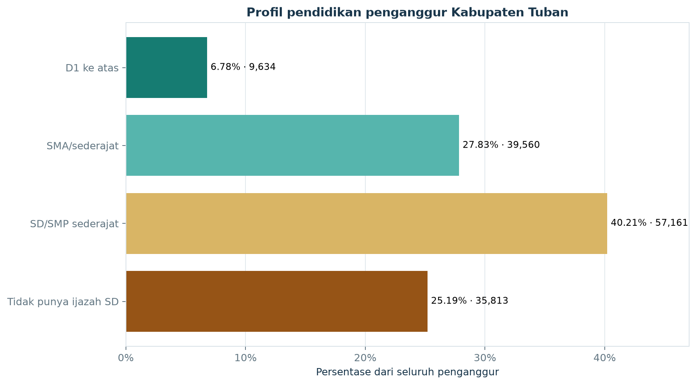{width="3.6805555555555554in"}

  ----------------------------------------------------------------
  Kelompok Analisis      Kategori
  ---------------------- -----------------------------------------
  Pendidikan rendah      Tidak punya ijazah SD, SD/SMP sederajat

  Pendidikan menengah    SMA/sederajat

  Pendidikan tinggi      Diploma I/II/III, Diploma IV/S1, S2/S3

  Tidak diketahui        Kategori Unknown/Tidak diketahui
  ----------------------------------------------------------------

  : **Tabel 4.1** Keterangan Kategori Pendidikan

> Berdasarkan Gambar 4.6, diketahui profil pendidikan terakhir penganggur di Kabupaten Tuban didominasi oleh kelompok berpendidikan rendah. Penganggur dengan pendidikan SD/SMP sederajat menempati jumlah terbesar, yaitu 40,21% (57.161 orang), diikuti kelompok tidak memiliki ijazah SD sebesar 25,19% (35.813 orang). Sementara itu, kelompok SMA/sederajat dengan persentase 27,83% (39.560 orang), dan persentase ke-4 dari kelompok D1 ke atas dengan 6,78% (9.634 orang).
>
> Secara komposisi, kelompok pendidikan rendah (SD/SMP sederajat dan tidak punya ijazah SD) mencakup 65,40% dari seluruh penganggur. Kelompok SMA/sederajat mencakup 27,83%, sedangkan D1 ke atas 6,78%. Angka ini menggambarkan komposisi pendidikan di antara penganggur, bukan tingkat pengangguran pada setiap jenjang; penghitungan tingkat tersebut memerlukan jumlah angkatan kerja pada masing-masing jenjang. Gambar 4.7 membandingkan jumlah penganggur berpendidikan rendah dan proporsinya terhadap seluruh penganggur di tiap desa/kelurahan.

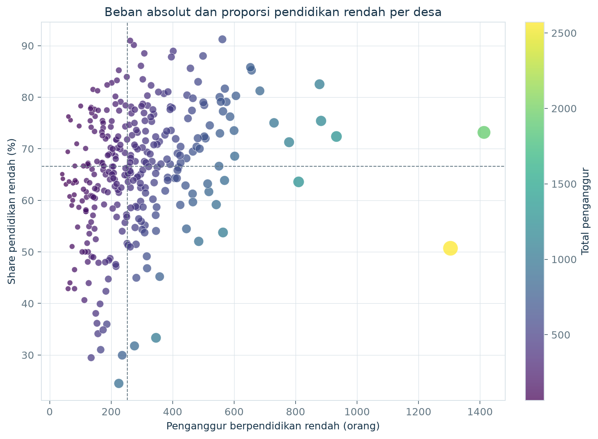{width="3.359890638670166in"}

> Berdasarkan Gambar 4.7, sebagian besar desa memiliki kurang dari sekitar 400 penganggur pendidikan rendah. Hanya beberapa desa yang jauh di kanan dengan beban sekitar 600-1.400 orang sehingga jumlah sasaran tidak tersebar merata karena menampung beban absolut lebih besar. Sebagian besar titik berada di 55-80% yang mana banyak desa yang lebih dari nilai median, artinya banyak desa yang pendidikan rendah didominasi oleh penganggur. Pola sebaran titik melebar, menandakan desa dengan proporsi tinggi belum tentu memiliki beban absolut terbesar, dan sebaliknya. Desa dengan sekitar 150-250 penganggur bisa memiliki proporsi lebih dari 80%, sedangkan desa dengan lebih dari 1.200 penganggur proporsinya sekitar 50%. Hal ini menunjukkan jumlah sasaran dan intensitas masalah adalah dua hal yang berbeda dan dinilai secara terpisah.
>
> Adapun grafik untuk kontras pada pendidikan rendah dan tinggi di Kabupaten Tuban berdasarkan kecamatan yang ditampilkan pada Gambar 4.8.

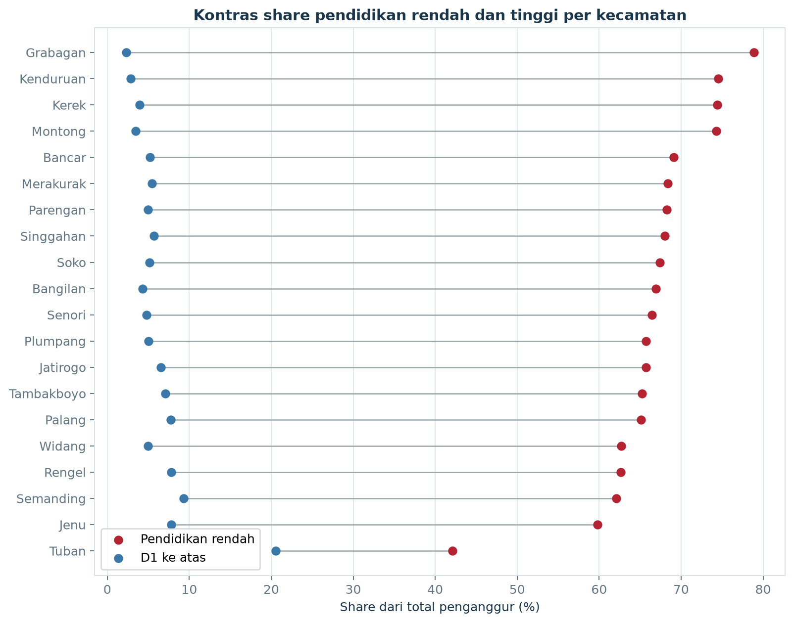{width="3.5559601924759403in"}

> Gambar 4.8 membandingkan proporsi penganggur berpendidikan rendah (merah) dan tinggi/D1 ke atas (biru) pada tiap kecamatan. Polanya serupa di hampir semua kecamatan: pendidikan rendah mendominasi (60–80%), sedangkan pendidikan tinggi umumnya di bawah 10%. Kesenjangan terbesar terlihat di Grabagan, Kenduruan, Kerek, dan Montong. Peta kontras proporsi penganggur berpendidikan rendah per desa/kelurahan ditampilkan pada Gambar 4.9.

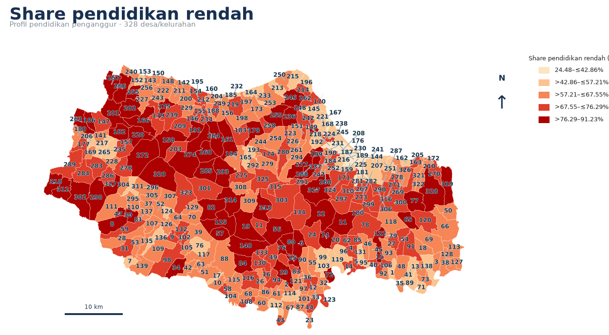{width="6in"}

### Jumlah Penyakit Kronis

> Penyakit kronis menggambarkan kondisi kesehatan penganggur. Tiga kelompok profilnya disajikan pada Gambar 4.10.

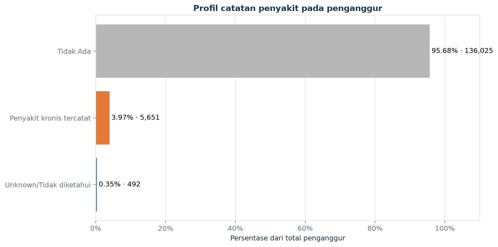{width="3.711797900262467in"}

> Berdasarkan Gambar 4.10, penganggur di Kabupaten Tuban adalah mayoritas tercatat tidak mengalami penyakit kronis sebesar 95,68%. Adapun yang tercatat sebesar 3,97% dan yang tidak tercatat sebesar 0,35% dari total penganggur. Selanjutnya, profil dari penganggur yang tercatat penyakit kronis dijelaskan dalam peringkat jumlah yang disajikan dalam Tabel 4.2.

  -----------------------------------------------------------------------------------
  Peringkat    Kondisi                Jumlah Penganggur   Proporsi Total Penganggur
  ------------ ---------------------- ------------------- ---------------------------
  1            Lainnya                1317                0,009264

  2            Rematik                1198                0,008427

  3            Hipertensi             799                 0,00562

  4            Diabetes               545                 0,003833

  5            Stroke                 465                 0,003271

  6            Asma                   431                 0,003032

  7            Kolesterol             407                 0,002863

  8            Masalah Jantung        233                 0,001639

  9            TBC                    86                  0,000605

  10           Kanker/Tumor Ganas     61                  0,000429

  11           Gagal Ginjal           51                  0,000359

  12           Leukimia               25                  0,000176

  13           Alzheimer              9                   0,000063

  14           Haemophilia            7                   0,000049

  15           Sirosis Hati           6                   0,000042

  16           HIV/AIDS               6                   0,000042

  17           Thalasemia             5                   0,000035
  -----------------------------------------------------------------------------------

  : **Tabel 4.2** Peringkat Kondisi Kesehatan yang Tercatat pada Penganggur Kabupaten Tuban

> Tabel 4.2 menunjukkan jumlah tertinggi tercatat pada kategori lainnya (1.317 penganggur) dan rematik (1.198 penganggur). Secara umum, penyakit kronis bukan faktor dominan di balik status pengangguran karena kondisi dengan jumlah tertinggi sekalipun hanya mencakup kurang dari 1% dari seluruh penganggur. Peta proporsi penyakit kronis per desa/kelurahan ditampilkan pada Gambar 4.11.

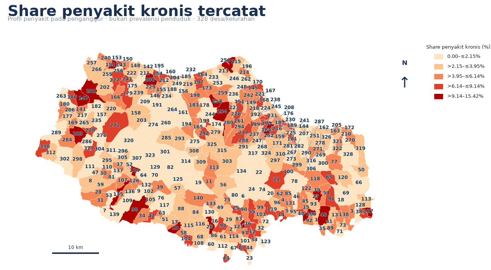{width="6in"}

## Korelasi Data

Korelasi Spearman digunakan untuk menggambarkan hubungan monoton antara TPT dan jumlah orang pada kategori pendidikan, penyakit kronis, dan sektor pekerjaan di 328 desa/kelurahan. Nilai *p-value* disesuaikan dengan metode Holm secara terpisah untuk tiap kelompok gambar. Titik menunjukkan jumlah absolut, sehingga asosiasi juga dapat mencerminkan skala desa/kelurahan; garis hanya menunjukkan kecenderungan linear untuk membantu membaca pola. Korelasi ini bersifat deskriptif, bukan ukuran pengaruh atau bukti sebab-akibat. Khusus pendidikan dan penyakit, hitungannya merupakan bagian dari jumlah penganggur yang juga menjadi pembilang TPT.

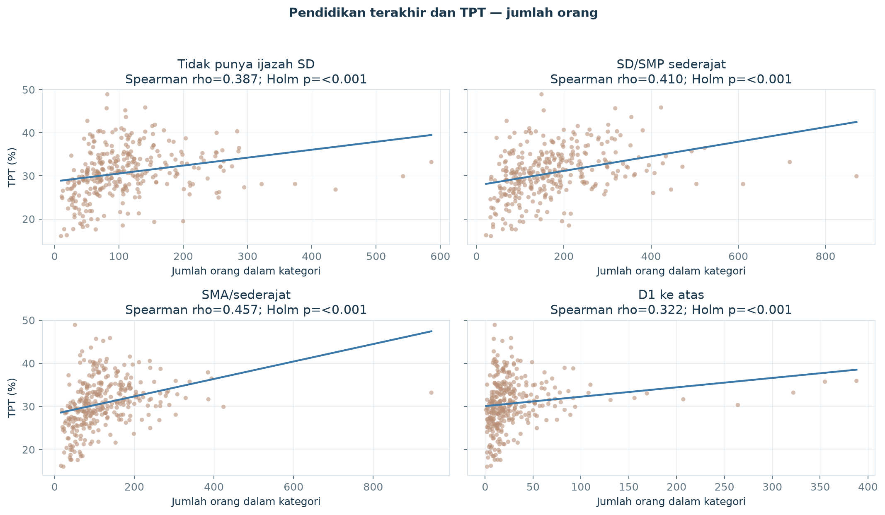{width="6in"}

Gambar 4.12 memperlihatkan hubungan monoton positif pada seluruh kelompok pendidikan: koefisien Spearman sebesar 0,387 untuk tidak punya ijazah SD, 0,410 untuk SD/SMP, 0,457 untuk SMA/sederajat, dan 0,322 untuk D1 ke atas. Seluruh *p-value* setelah koreksi Holm <0,001. Karena yang dibandingkan adalah jumlah penganggur pada tiap kategori, pola tersebut tidak menunjukkan bahwa jenjang pendidikan tertentu meningkatkan risiko menganggur.

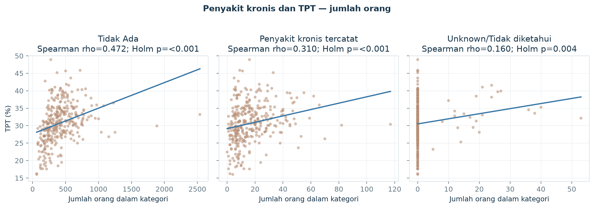{width="6in"}

Pada Gambar 4.13, korelasi positif terbesar terdapat pada jumlah penganggur yang tercatat tidak mengalami penyakit kronis (ρ=0,472), disusul penyakit kronis tercatat (ρ=0,310) dan kondisi tidak diketahui (ρ=0,160). Setelah koreksi Holm, *p-value* masing-masing adalah <0,001, <0,001, dan 0,004. Angka tersebut adalah jumlah penganggur dalam tiap kelompok, bukan prevalensi penyakit pada seluruh penduduk; hasilnya tidak membuktikan hubungan sebab-akibat.

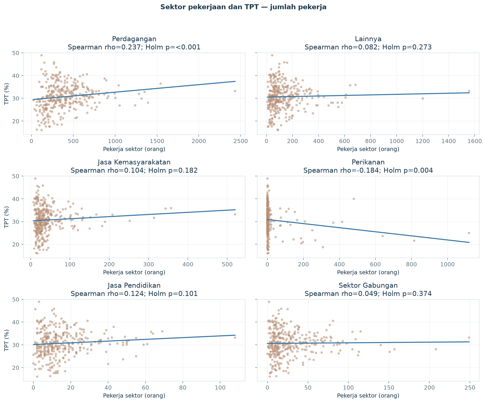{width="6in"}

Gambar 4.14 menyajikan enam kelompok pekerjaan pada Tabel 3.3: Perdagangan, Lainnya, Jasa Kemasyarakatan, Perikanan, Jasa Pendidikan, dan Sektor Lain. Untuk grafik ini, Sektor Lain dioperasionalkan sebagai Peternakan dan delapan kolom pekerjaan lain setelah lima kategori khusus serta Pertanian Padi & Palawija dikeluarkan. Tabel 3.3–3.4 tidak merinci pemetaan kolom untuk agregat ini; karena itu, pengelompokan tersebut merupakan definisi Gambar 4.14, bukan klaim bahwa nilainya identik dengan `share_sektor_lain_ref` pada OLS. Hubungan TPT dengan jumlah pekerja Perdagangan positif (ρ=0,237; Holm *p*<0,001), sedangkan dengan jumlah pekerja Perikanan negatif (ρ=−0,184; Holm *p*=0,004). Korelasi Lainnya (ρ=0,082; Holm *p*=0,273), Jasa Kemasyarakatan (ρ=0,104; Holm *p*=0,182), Jasa Pendidikan (ρ=0,124; Holm *p*=0,101), dan Sektor Lain (ρ=0,049; Holm *p*=0,374) tidak signifikan setelah koreksi Holm. Grafik membandingkan jumlah absolut, bukan proporsi; pola ini bersifat asosiatif dan tidak menunjukkan sebab-akibat.

## Analisis Model OLS

Variabel respons yang digunakan adalah TPT_Proxy, sedangkan variabel prediktornya adalah proporsi penduduk bekerja pada enam kelompok sektor pekerjaan, yaitu share_perdagangan, share_lainnya, share_jasa_kemasyarakatan, share_perikanan, share_jasa_pendidikan, dan share_sektor_lain_ref. Variabel share_pertanian digunakan sebagai kategori referensi dan tidak dimasukkan secara bersamaan ke dalam model karena seluruh proporsi sektor pekerjaan membentuk suatu komposisi.

Bentuk model OLS yang digunakan dapat dituliskan sebagai berikut.

$$TPT_{Proxy_{i}} = \beta_{0} + \beta_{1}X_{1i} + \beta_{2}X_{2i} + \beta_{3}X_{3i} + \beta_{4}X_{4i} + \beta_{5}X_{5i} + \beta_{6}X_{6i} + \varepsilon_{i} \ $$

Karena prediktor berupa proporsi sektor pekerjaan, koefisien dibaca relatif terhadap share_pertanian. Sebelum melakukan pengujian parsial terhadap masing-masing koefisien, dilakukan uji *F* secara serentak. Hipotesis serentak yang diuji sebagai berikut.

$H_{0}:\beta_{1} = \beta_{2} = \ldots = \beta_{6} = 0$

$H_{1}:$ minimal terdapat satu $\beta_{j} \neq 0$

Hasil uji *F* diperoleh nilai statistik $F_{6,321} = 12,6777$ dengan nilai *p-value* sebesar $7,62 \times 10^{- 13}$. Karena *p-value* lebih kecil daripada taraf signifikansi 5%, $H_{0}$ ditolak sehingga secara serentak struktur sektor pekerjaan berhubungan signifikan dengan TPT Proxy. Hasil ini menjadi dasar untuk melanjutkan interpretasi koefisien secara parsial, tetapi dibaca sebagai hasil *baseline global* karena heteroskedastisitas dan autokorelasi residual terdeteksi.

  -----------------------------------------------------------------------------------------
  Variabel                      Koefisien       SE         t    p-value              95% CI
  --------------------------- ----------- -------- --------- ---------- -------------------
  Intersep                         0,2428   0,0102   23,8011    \<0,001    (0,2227; 0,2629)

  share_perdagangan                0,1641   0,0229    7,1785    \<0,001    (0,1192; 0,2091)

  share_lainnya                    0,0261   0,0414    0,6296     0,5294   (-0,0554; 0,1076)

  share_jasa_kemasyarakatan        0,0784   0,1252    0,6262     0,5317   (-0,1680; 0,3248)

  share_perikanan                 -0,0858   0,0330   -2,5962     0,0099          (-0,1508;\
                                                                                   -0,0208)

  share_jasa_pendidikan            0,0541   0,3491    0,1549     0,8770   (-0,6328; 0,7410)

  share_sektor_lain_ref           -0,3097   0,1532   -2,0221     0,0440          (-0,6111;\
                                                                                   -0,0084)
  -----------------------------------------------------------------------------------------

  : **Tabel 4.3** Estimasi Parameter Model OLS

Berdasarkan *p-value* OLS konvensional pada taraf signifikansi 5%, terdapat tiga prediktor yang menunjukkan hubungan signifikan dengan TPT Proxy, yaitu share_perdagangan ($X_{1}$), share_perikanan ($X_{4}$), dan share_sektor_lain_ref ($X_{6}$). Adapun share_lainnya ($X_{2}$), share_jasa_kemasyarakatan ($X_{3}$), dan share_jasa_pendidikan ($X_{5}$) tidak signifikan pada taraf 5%, sehingga belum terdapat cukup bukti berdasarkan model OLS global untuk menyatakan bahwa ketiga prediktor tersebut memiliki hubungan yang berbeda secara statistik terhadap TPT Proxy dibandingkan dengan kategori referensi, yaitu sektor pertanian. Pemeriksaan diagnostik dilakukan untuk menilai keterbatasan model global sebelum dilanjutkan ke analisis GWR.

+----------------------+---------------+----------------------------------------------------------------+
| > Diagnostik         | > Hasil       | > Interpretasi                                                 |
+:====================:+:=============:+================================================================+
| > VIF                | > 1,142-1,747 | > Tidak terdapat indikasi multikolinearitas global yang serius |
+----------------------+---------------+----------------------------------------------------------------+
| > Breusch--Pagan LM  | > p = 0,0029  | > Terdapat indikasi heteroskedastisitas                        |
+----------------------+---------------+----------------------------------------------------------------+
| > Moran's I residual | > 0,2132      | > Terdapat autokorelasi spasial positif yang signifikan        |
|                      | >             |                                                                |
|                      | > p = 0,001   |                                                                |
+----------------------+---------------+----------------------------------------------------------------+

: **Tabel 4.4** Hasil Diagnostik Model OLS

Nilai VIF seluruh prediktor berada pada rentang 1,142--1,747, sehingga tidak terdapat indikasi multikolinearitas global yang serius pada spesifikasi dengan share_pertanian sebagai kategori referensi. Uji Breusch--Pagan menghasilkan *p-value* sebesar 0,0029 pada versi LM yang menunjukkan adanya indikasi heteroskedastisitas. Selain itu, pengujian Moran's I menggunakan matriks bobot spasial *Queen contiguity* yang distandarisasi berdasarkan baris dan 999 permutasi menghasilkan nilai Moran's I residual OLS sebesar 0,2132 dengan *p-value* 0,001, sehingga menunjukkan adanya autokorelasi spasial positif yang signifikan pada residual OLS. Heteroskedastisitas terdeteksi dan autorkorelasi spasial positif, tetapi hasil signifikansi model tidak diperlakukan sebagai bukti kausal maupun bukti final mengenai pola spasial. Berikut ringkasan hasil model OLS disajikan pada Tabel 4.5.

**Tabel 4.5** Ringkasan Hasil Model OLS

+-----------------------------------------+----------------+
| > Ukuran                                | > Nilai        |
+:=======================================:+:==============:+
| > Jumlah observasi                      | > 328          |
+-----------------------------------------+----------------+
| > R²                                    | > 0,1916       |
+-----------------------------------------+----------------+
| > Adjusted R²                           | > 0,1765       |
+-----------------------------------------+----------------+
| > RMSE in-sample (berdasarkan residual) | > 0,05099      |
+-----------------------------------------+----------------+
| > RMSE (poin persentase TPT Proxy)      | > 5,10         |
+-----------------------------------------+----------------+
| > AICc                                  | > -1007,2186   |
+-----------------------------------------+----------------+
| > Statistik F(6,321)                    | > 12,6777      |
+-----------------------------------------+----------------+
| > p-value uji F                         | > 7,62 × 10⁻¹³ |
+-----------------------------------------+----------------+

Berdasarkan uji simultan, diperoleh p-value sebesar 7,62 × 10⁻¹³ yang lebih kecil dari taraf signifikansi 5%, sehingga hipotesis nol yang menyatakan bahwa seluruh koefisien prediktor sama dengan nol ditolak. Hasil ini menunjukkan bahwa secara simultan terdapat hubungan antara struktur sektor pekerjaan dan TPT Proxy. Nilai R² sebesar 0,1916 menunjukkan bahwa enam prediktor dalam model mampu menjelaskan sekitar 19,16% variasi TPT Proxy antarwilayah, sedangkan adjusted R² sebesar 0,1765 menunjukkan bahwa setelah mempertimbangkan jumlah prediktor, kemampuan penjelasan model menjadi sekitar 17,65%. Dengan demikian, struktur sektor pekerjaan belum mampu menjelaskan seluruh variasi TPT Proxy antar desa/kelurahan.

Sementara itu, nilai RMSE sebesar 0,05099 menunjukkan besarnya akar rata-rata kuadrat residual pada 328 observasi yang digunakan dalam estimasi model secara in-sample, yang setara dengan sekitar 5,10 poin persentase karena TPT Proxy dinyatakan dalam skala proporsi. Adapun nilai AICc digunakan sebagai ukuran pembanding antara model OLS dan GWR pada tahap analisis berikutnya, sehingga tidak ditafsirkan secara terpisah.

## Deskripsi Data

Sebelum melakukan analisis dengan metode GWR, perlu untuk mengetahui apa saja informasi yang didapatkan dari variabel data pengangguran. Analisis yang dilakukan dengan statistika deskriptif dari variabel prediktor dan respon. Statistika deskriptif disajikan pada Tabel 4.6.

  ---------------------------------------------------------------------------
  Variabel           *Mean*      StanDev          Min       Median       Maks
  ------------ ------------ ------------ ------------ ------------ ----------
  $$Y$$              30,717        5,679       16,029       30,628     48,911

  $$X_{1}$$          41,082       13,791        8,391       41,137     72,596

  $$X_{2}$$          13,924        9,090        1,123       12,020     42,460

  $$X_{3}$$           4,426        3,001        0,697        3,741     20,750

  $$X_{4}$$           2,550        9,221            0        0,136     66,759

  $$X_{5}$$           1,595        1,000            0        1,450      5,433

  $$X_{6}$$           2,861        2,215            0        2,263     16,398
  ---------------------------------------------------------------------------

  : []{#_Toc240218738 .anchor}**Tabel 4.6** Statistika Deskriptif Variabel Penelitian

Berdasarkan Tabel 4.6, diketahui bahwa variabel $Y$ (Tingkat Pengangguran Terbuka) relatif homogen. Nilai *mean* (30,717) dan median (30,628) hampir sama, dan standar deviasinya kecil dibanding mean-nya. Ini menandakan sebaran data cenderung simetris/normal antar wilayah, tidak banyak outlier ekstrem.

Pada variabel $X_{4}$ (Persentase Perikanan) adalah yang paling mencolok sangat skewed karena nilai *mean* (2,550), tapi median (0,136) yang jauh lebih kecil dan nilai StanDev (9,221) bahkan lebih besar dari *mean.* Dalam artian sebagian besar wilayah punya persentase sektor perikanan yang sangat kecil mendekati nol, tapi ada beberapa wilayah dengan nilai ekstrem sangat tinggi. Distribusinya menceng kanan (*right-skewed*) secara ekstrem. Pada variabel $X_{2}$ (Persentase Lainnya), $X_{3}$ (Persentase Jasa Kemasyarakatan), dan $X_{6}$ (Persentase Sektor Lainnya) juga menceng kanan, *mean* lebih besar dari median, dan standar deviasi cukup besar relatif terhadap *mean*-nya menunjukkan ada variasi antar wilayah yang cukup besar, dengan beberapa wilayah bernilai jauh di atas rata-rata.

Pada variabel $X_{1}$ (Persentase Perdagangan) dan $X_{5}$ (Persentase Jasa Pendidikan) paling stabil. Variabel persentasi perdagangan dengan *mean* (41,082) dan median (41,137), serta variabel persentasai jasa pendidikan dengan *mean* (1,595) dan median (1,450). Persebaran kedua sektor cukup merata kontribusinya di berbagai wilayah, hanya membedakan sektor perdagangan lebih dominan di Kabupaten Tuban.

## Analisis Model GWR

Penggunaan GWR didasarkan pada hasil diagnostik model OLS. Moran's I residual OLS menunjukkan adanya autokorelasi spasial positif yang signifikan. Dengan demikian, model global belum sepenuhnya menangkap struktur geografis pada data. GWR digunakan untuk mengevaluasi apakah hubungan antara struktur sektor pekerjaan dan TPT Proxy mengalami ketidakstasioneran spasial. Interpretasi yang dihasilkan tetap bersifat asosiatif dan tidak dimaksudkan sebagai bukti hubungan sebab-akibat.

Model GWR menggunakan 328 desa/kelurahan sebagai unit analisis. Diperlukan koordinat lokasi dimana digunakan untuk menghitung jarak dan membentuk bobot spasial. Pemilihan kernel dan *bandwidth* dilakukan menggunakan kriteria AICc. *Bandwidth* yang digunakan bersifat *adaptive nearest-neighbor*, sehingga angka *bandwidth* menunjukkan skala jumlah tetangga terdekat yang digunakan untuk membentuk bobot pada setiap lokasi. Hasil perbandingan kernel disajikan pada Tabel 4.7.

[]{#_Toc240218742 .anchor}**Tabel 4.7** Perbandingan Kernel dan Bandwidth GWR

+-------------------+-------------------+---------------+-------------+
| > Kernel          | > Bandwidth       | > AICc        | > R²        |
+:=================:+:=================:+:=============:+:===========:+
| > Gaussian        | > 43              | > -1059,12    | > 0,4062    |
+-------------------+-------------------+---------------+-------------+
| > Exponential     | > 39              | > -1058,68    | > 0,4360    |
+-------------------+-------------------+---------------+-------------+
| > Bisquare        | > 210             | > -1057,30    | > 0,3798    |
+-------------------+-------------------+---------------+-------------+

Berdasarkan Tabel 4.7, Kernel *Gaussian* dengan *bandwidth* adaptif 43 dipilih sebagai spesifikasi utama karena menghasilkan nilai AICc paling rendah. Meskipun kernel *exponential* menghasilkan R² yang lebih tinggi, yaitu 0,4360 dibandingkan 0,4062 pada kernel *Gaussian*, pemilihan model tidak didasarkan pada R² saja.

Uji kesamaan model global dengan lokal digunakan untuk mengevaluasi apakah seluruh koefisien lokal GWR sama dengan koefisien global OLS. Hipotesis yang kesamaan model sebagai berikut.

$$H_{0}:\beta_{j}\left( u_{i},v_{i} \right) = \beta_{j};j = 0,1,2,\ldots,6;\ i = 1,2,\ldots,328$$

$H_{1}:$ minimal ada satu $\beta_{j}\left( u_{i},v_{i} \right) \neq \beta_{j}$

Pada spesifikasi GWR Gaussian dengan bandwidth adaptif 43, diperoleh statistik uji $F_{GWR}$ sebesar 1,2323 dengan $df_{1} = 321$, $df_{2} = 290,5357$, dan *p-value* sebesar 0,0347. Karena *p-value* lebih kecil daripada taraf signifikansi 5%, hipotesis $H_{0}$ ditolak. Hasil ini memberikan bukti pendukung bahwa paling sedikit satu parameter lokal GWR berbeda dari parameter global OLS.

Diagnostik GWR digunakan untuk memeriksa apakah pemodelan lokal mengurangi struktur spasial residual. Berikut adalah hipotesis dan hasil statistik uji.

$H_{0}:I = 0$ (Residual tidak menunjukkan autokorelasi spasial)

$H_{1}:I \neq 0$ (Residual menunjukkan autokorelasi spasial)

Moran's I residual GWR sebesar 0,0587 dengan *p-value* adalah 0,038 lebih rendah dibandingkan Moran's I residual OLS sebesar 0,2132. Hasil ini menunjukkan bahwa GWR mengurangi autokorelasi spasial residual secara substansial. Namun, residual GWR masih memiliki autokorelasi spasial kecil yang signifikan pada taraf 5%, sehingga struktur spasial belum dapat dinyatakan hilang sepenuhnya.

Adapun ringkasan hasil model lokal GWR yang disajikan pada Tabel 4.8.

[]{#_Toc240218743 .anchor}**Tabel 4.8** Ringkasan Hasil Model GWR

+-------------------------------------+------------------+
| > Ukuran                            | > Nilai          |
+:===================================:+:================:+
| > Jumlah observasi                  | > 328            |
+-------------------------------------+------------------+
| > R²                                | > 0,4062         |
+-------------------------------------+------------------+
| > Adjusted R²                       | > 0,3508         |
+-------------------------------------+------------------+
| > RMSE in-sample                    | > 0,04370        |
+-------------------------------------+------------------+
| > RMSE (poin persentase TPT Proxy)  | > 4,37           |
+-------------------------------------+------------------+
| > AICc                              | > -1059,12       |
+-------------------------------------+------------------+
| > Local R² minimum-maksimum         | > 0,1161--0,4946 |
+-------------------------------------+------------------+
| > Median Local R²                   | > 0,2889         |
+-------------------------------------+------------------+

Nilai R² sebesar 0,4062 menunjukkan bahwa model GWR menjelaskan sekitar 40,62% variasi TPT Proxy dalam ukuran kecocokan model yang digunakan. Adjusted R² sebesar 0,3508 memperhitungkan kompleksitas model. RMSE sebesar 0,04370 pada skala proporsi setara dengan sekitar 4,37 poin persentase TPT Proxy. Local R² berada pada rentang 0,1161 sampai 0,4946 dengan median 0,2889. Rentang tersebut menunjukkan bahwa kemampuan model dalam menjelaskan TPT Proxy berbeda antarwilayah.

## Interpretasi Model GWR

Ringkasan hasil estimasi koefisien model lokal menggunakan rentang nilai, jumlah lokasi yang signifikan setelah koreksi multiple testing, dan pola tanda koefisien. Seluruh koefisien merupakan kontras terhadap share_pertanian. Oleh karena itu, koefisien tidak dibaca sebagai perubahan absolut yang berdiri sendiri. Berikut adalah ringkasan yang disajikan pada Tabel 4.9.

[]{#_Toc240218744 .anchor}**Tabel 4.9** Ringkasan Koefisien Lokal Model GWR

+---------------------+---------------------+---------------------+-----------------------------+
| > Prediktor         | > Rentang koefisien | > Lokasi signifikan | > Pola tanda                |
+=====================+:===================:+:===================:+=============================+
| > share_perdagangan | 0,0205 s.d. 0,2214  | > 190/328           | > Positif di 328/328 lokasi |
+---------------------+---------------------+---------------------+-----------------------------+
| > share_lainnya     | -0,1229 s.d. 0,1018 | > 0/328             | > Berubah tanda             |
+---------------------+---------------------+---------------------+-----------------------------+
| > share_jasa\_      | -0,3940 s.d. 0,4504 | > 30/328            | > Berubah tanda             |
| > kemasyarakatan    |                     |                     |                             |
+---------------------+---------------------+---------------------+-----------------------------+
| > share_perikanan   | -0,1680 s.d. 0,0255 | > 100/328           | > Negatif di 294/328 lokasi |
+---------------------+---------------------+---------------------+-----------------------------+
| > share_jasa\       | -0,8273 s.d. 1,1680 | > 0/328             | > Berubah tanda             |
| > \_pendidikan      |                     |                     |                             |
+---------------------+---------------------+---------------------+-----------------------------+
| > share_sektor\     | -0,6266 s.d. 0,2712 | > 37/328            | > Berubah tanda             |
| > \_lain_ref        |                     |                     |                             |
+---------------------+---------------------+---------------------+-----------------------------+

Koefisien lokal share_perdagangan ($X_{1}$) bernilai positif di seluruh 328 lokasi dan signifikan setelah koreksi *multiple testing* di 190 lokasi. Jadi, relatif terhadap share_pertanian, proporsi sektor perdagangan berasosiasi dengan nilai TPT Proxy yang lebih tinggi di seluruh lokasi, tetapi besar asosiasinya berbeda antarwilayah.

Koefisien lokal share_perikanan ($X_{4}$) bernilai negatif di 294 dari 328 lokasi dan signifikan di 100 lokasi. Secara relatif terhadap share_pertanian, share_perikanan cenderung berasosiasi dengan nilai TPT Proxy yang lebih rendah di sebagian besar lokasi, tetapi pola tersebut tidak signifikan secara lokal di seluruh wilayah.

Koefisien share_lainnya ($X_{2}$), share_jasa_kemasyarakatan ($X_{3}$), share_jasa_pendidikan ($X_{5}$), dan share_sektor_lain_ref ($X_{6}$) berubah tanda antarwilayah. Perubahan tanda menunjukkan bahwa arah asosiasi relatif terhadap share_pertanian tidak seragam secara geografis. Karena signifikansi lokalnya terbatas atau tidak ditemukan, prediktor-prediktor tersebut tidak diringkas sebagai hubungan yang berlaku umum di seluruh Kabupaten Tuban.

Model GWR mengestimasi parameter yang dapat berbeda pada setiap lokasi, Tabel 4.9 merangkum variasi koefisien pada 328 desa/kelurahan. Tabel 4.10 menyajikan intersep dan enam koefisien lokal untuk salah satu kelurahan/desa, yaitu Kelurahan Gedongombo, Kecamatan Semanding (kode_kd 35.23.15.1015). Berikut adalah estimasi parameter model GWR *adaptive gaussian* pada Kelurahan Gedongombo.

[]{#_Toc240218745 .anchor}**Tabel 4.10** Estimasi Parameter Model GWR pada Kel. Gedongombo

+-------------------+-------------+----------+-----------------+-------------+----------------------+
| > Variabel        | > Koefisien | > SE     | > $$T_{j,GWR}$$ | > *p-value* | > CI 95%             |
+===================+:===========:+:========:+:===============:+:===========:+:====================:+
| > Intersep        | > 0,2983    | > 0,0226 | > 13,2155       | > \<0,001   | > (0,2539; 0,3427)   |
+-------------------+-------------+----------+-----------------+-------------+----------------------+
| > share\_         | > 0,0536    | > 0,0478 | > 1,1218        | > 0,2628    | > (-0,0404; 0,1476)  |
| > perdagangan     |             |          |                 |             |                      |
+-------------------+-------------+----------+-----------------+-------------+----------------------+
| > share_lainnya   | > -0,0616   | > 0,0745 | > -0,8266       | > 0,4091    | > (-0,2082; 0,0850)  |
+-------------------+-------------+----------+-----------------+-------------+----------------------+
| > share_jasa\_    | > 0,2591    | > 0,1581 | > 1,6388        | > 0,1022    | > (-0,0519; 0,5701)  |
| > kemasyarakatan  |             |          |                 |             |                      |
+-------------------+-------------+----------+-----------------+-------------+----------------------+
| > share_perikanan | > 0,0102    | > 0,0508 | > 0,2016        | > 0,8404    | > (-0,0896; 0,1101)  |
+-------------------+-------------+----------+-----------------+-------------+----------------------+
| > share_jasa\_    | > 0,7011    | > 0,5870 | > 1,1944        | > 0,2332    | > (-0,4537; 1,8559)  |
| > pendidikan      |             |          |                 |             |                      |
+-------------------+-------------+----------+-----------------+-------------+----------------------+
| > share_sektor\_  | > -0,5556   | > 0,2502 | > -2,2203       | > 0,0271    | > (-1,0478; -0,0633) |
| > lain_ref        |             |          |                 |             |                      |
+-------------------+-------------+----------+-----------------+-------------+----------------------+

Pada Tabel 4.10, koefisien share_sektor_lain_ref ($X_{6})$ bernilai $- 0,5556$ dan memiliki *p-value* sebesar 0,0271. Koefisien tersebut merupakan kontras relatif terhadap share_pertanian dan secara tak terkoreksi berasosiasi dengan nilai TPT Proxy yang lebih rendah ketika share_sektor_lain_ref lebih besar relatif terhadap share_pertanian, dengan prediktor lain dianggap tetap. Namun, nilai $T_{6,GWR}$ sebesar -2,2203 lebih kecil daripada nilai $t_{tabel} = 2,5107$. Oleh karena itu, tidak ada satu pun dari enam prediktor yang dinyatakan signifikan secara lokal di Gedongombo setelah koreksi multiple testing.

## Dashboard

Hasil analisis EDA dan model GWR, diperlukan tampilan yang menarik sehingga diperlukan sebuah dashboard untuk menampung analisis dan peta spasial. Berikut adalah bagian-bagian dari dashboard.

https://www.canva.com/design/DAHRMKvrt60/nRzzhQLHdLpr6CZt2DCgLA/edit

1. Ringkasan Kabupaten Tuban

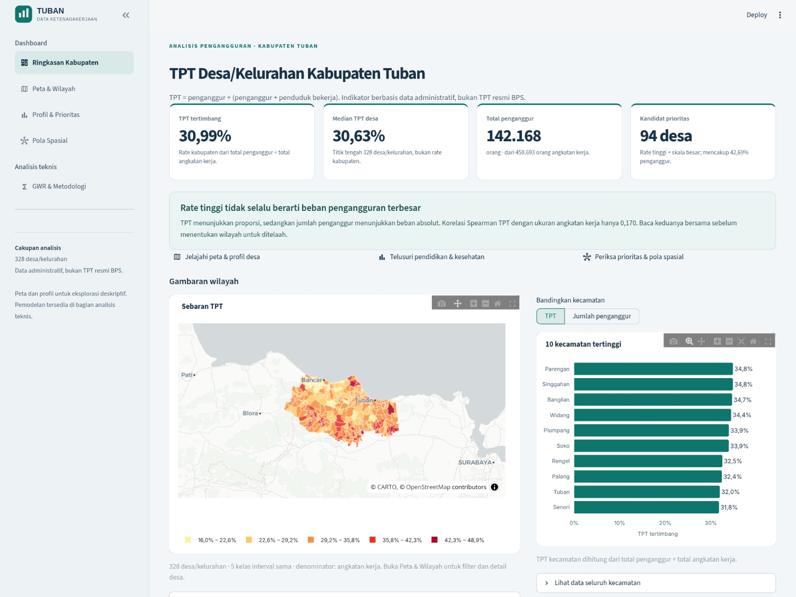{width="3.8319860017497813in"}

2. Peta & Wilayah

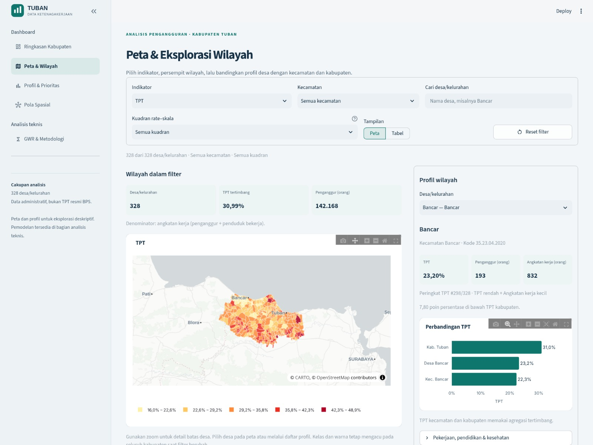{width="3.891509186351706in"}

3. Profil & Prioritas

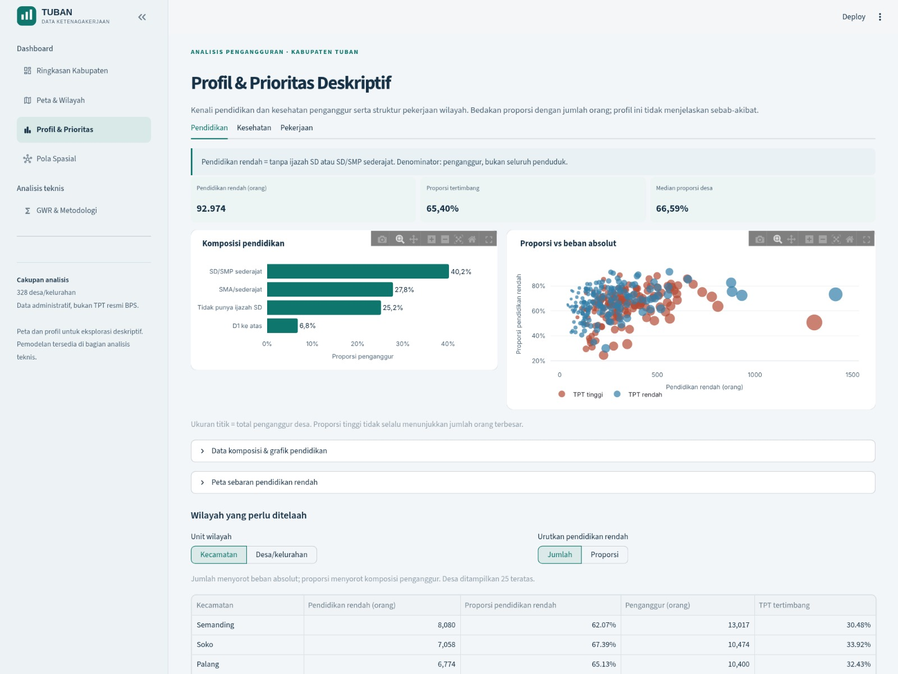{width="3.8447451881014874in"}

4. Pola Spasial

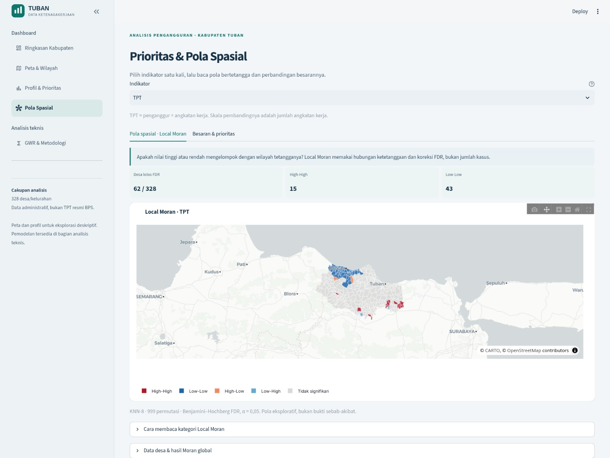{width="3.878248031496063in"}

5. GWR & Metodologi

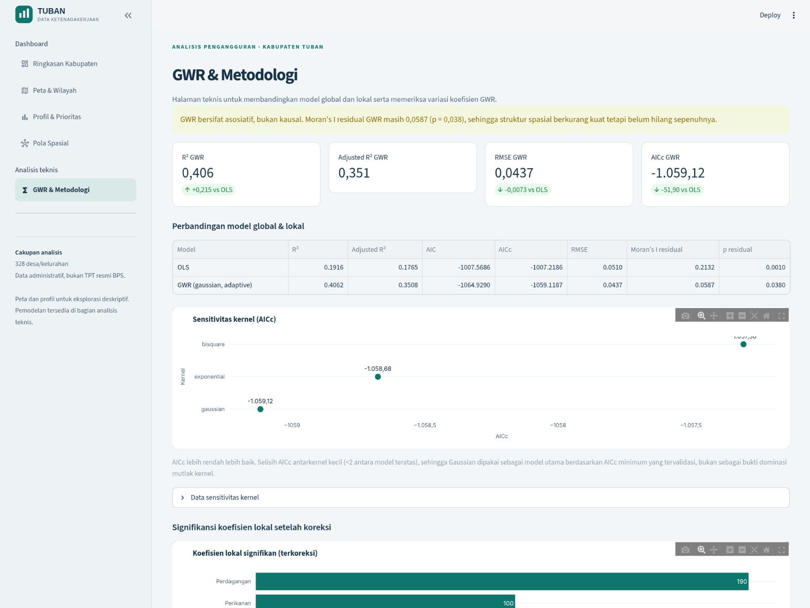{width="3.8366196412948383in"}
